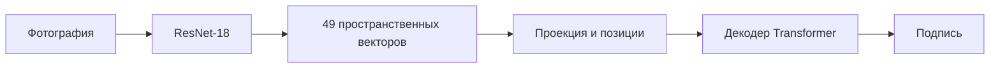
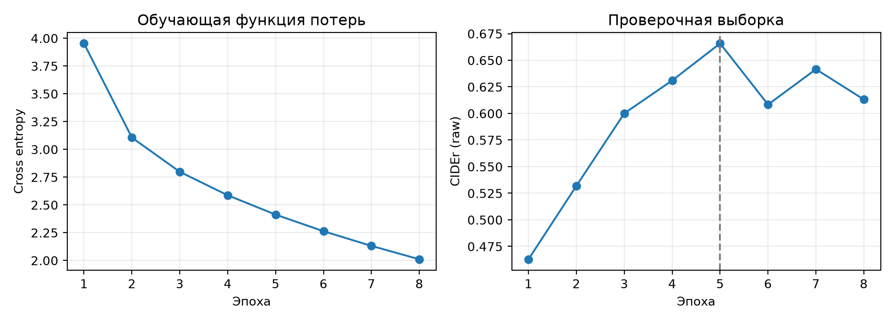
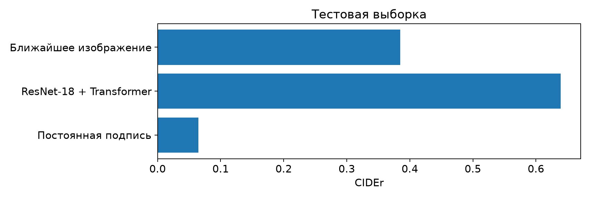

# Генерация текстового описания изображения

Цель работы состоит в том, чтобы научить модель составлять короткое описание фотографии
на английском языке. Для этого нужно распознать основные объекты, определить, что происходит
в кадре, и связать эти сведения в предложение. Модель обучена на подмножестве MS-COCO 2014
и сравнена с двумя простыми способами получения подписи.

## 1. Вариант / задача

На вход модели подаётся фотография, на выходе получается текстовая подпись. В работе
используются 5000 изображений MS-COCO 2014. Из них 4000 выделены для обучения, 500 для
проверки качества во время обучения и 500 для окончательного тестирования. Обучающие
фотографии взяты из train2014, проверочные и тестовые из val2014.

Все подписи одной фотографии сохраняются в одной выборке. Иначе модель могла бы получить
одну подпись при обучении, а затем оцениваться на другой подписи того же изображения.
Отбор фотографий воспроизводим: идентификаторы упорядочены по их SHA-256, и первые элементы
использованы для формирования выборок.

| Выборка | Источник | Изображений | Подписей |
| --- | --- | --- | --- |
| Обучающая | train2014 | 4000 | 20010 |
| Проверочная | val2014 | 500 | 2500 |
| Тестовая | val2014 | 500 | 2500 |
| Всего | MS-COCO 2014 | 5000 | 25010 |

<p align="center">Таблица 1. Состав подвыборки MS-COCO 2014</p>

В [MS-COCO Captions](https://arxiv.org/abs/1504.00325) у фотографии есть несколько описаний,
составленных людьми. Они могут называть разные детали одной сцены и использовать разные
слова. Поэтому при оценке учитываются все имеющиеся описания, а не только одна фраза.
Собственное разбиение из этой работы отличается от стандартного Karpathy test 5k;
результаты на этих выборках напрямую не сравниваются.

## 2. Литературный обзор

В [Show and Tell](https://arxiv.org/abs/1411.4555) изображение сначала обрабатывается
нейронной сетью, а затем текстовый декодер последовательно предсказывает слова подписи.
Такой подход позволяет обучать генерацию текста по парам «изображение и описание».
При сжатии всей фотографии в один вектор часть пространственной информации может теряться.

В [Show, Attend and Tell](https://arxiv.org/abs/1502.03044) используется визуальное внимание.
Декодер обращается к разным областям фотографии в зависимости от того, какое слово
предсказывает. Вместо единственного общего вектора можно сохранить карту признаков
и дать декодеру выбирать нужные участки.

Для извлечения визуальных признаков в этой работе выбран ResNet-18.
[Остаточные связи](https://arxiv.org/abs/1512.03385) упрощают обучение глубоких сетей,
а готовые веса ImageNet позволяют использовать уже выученные признаки объектов.
Замораживание кодировщика уменьшает число обучаемых параметров, что полезно при небольшой
выборке из 4000 фотографий.

Текстовый декодер построен на основе [Transformer](https://arxiv.org/abs/1706.03762).
Самовнимание учитывает ранее предсказанные слова, а перекрёстное внимание связывает текст
с пространственными признаками изображения. В выбранной архитектуре сочетаются
свёрточный кодировщик ResNet и декодер Transformer.

Использованы [веса ResNet-18 ImageNet-1K V1](https://docs.pytorch.org/vision/0.21/models/generated/torchvision.models.resnet18.html).
Они получены при классификации изображений ImageNet. Декодер подписей обучается с нуля;
готовая модель, ранее обученная описывать фотографии COCO, в эксперименте не используется.
Возможные совпадения фотографий между ImageNet и COCO отдельно не проверялись.

## 3. Архитектура решения

Фотография переводится в RGB, масштабируется и обрезается до 224 × 224 пикселей.
После нормализации она поступает в ResNet-18. Кодировщик формирует 49 пространственных
векторов размерности 512. Линейная проекция уменьшает их размерность до 256, а обучаемые
позиционные векторы сохраняют информацию о расположении ячеек.

Декодер содержит два слоя Transformer с четырьмя головами внимания. Во время обучения
веса ResNet и статистики BatchNorm остаются постоянными. Обучаются проекция, позиции,
словарные представления и сам декодер.



<p align="center">Рисунок 1. Архитектура решения</p>

Словарь построен по обучающим подписям. В него входят слова, встретившиеся не менее двух раз,
и специальные токены начала, конца, неизвестного слова и дополнения последовательности.
Всего в словаре 3824 токена. Длина подписи ограничена 32 токенами вместе с началом и концом.

При обучении декодеру передаётся эталонная подпись со сдвигом на один токен.
Причинная маска закрывает будущие слова. Токены дополнения PAD не участвуют в функции потерь:

$$
\mathcal{L}=-\frac{1}{N}\sum_{i=1}^{N}\log p_{\theta}(y_i\mid y_{<i}, I)
$$

Здесь I обозначает изображение, y_i соответствует очередному слову эталонной подписи,
а N равно числу целевых токенов без PAD. При генерации на каждом шаге выбирается слово
с наибольшей вероятностью. Построение подписи заканчивается при появлении EOS или
достижении предельной длины.

## 4. Метрики

Основной метрикой выбран [CIDEr](https://arxiv.org/abs/1411.5726). Он оценивает совпадение
предсказанной подписи с несколькими эталонами по взвешенным n-граммам. Часто встречающиеся
обороты получают меньший вес, чем более характерные для изображения сочетания слов.
Используется реализация `Cider(n=4, sigma=6)` из `pycocoevalcap==1.2`, включающая ограничение
повторов и штраф за различие длин предложений.

Дополнительно вычисляются BLEU-1, BLEU-2, BLEU-3, BLEU-4, METEOR и ROUGE-L.
BLEU отражает точность совпадения n-грамм, ROUGE-L учитывает общую подпоследовательность слов,
а METEOR допускает более гибкое сопоставление словоформ и синонимов.

Для всех методов использованы [COCO evaluation tools](https://github.com/salaniz/pycocoevalcap)
версии 1.2 и Stanford PTBTokenizer 3.4.1. Перед расчётом текст приводится к нижнему регистру,
пунктуация обрабатывается по правилам COCO. Один прогноз сравнивается со всеми эталонными
подписями соответствующей фотографии.

Значения приведены в исходной шкале библиотеки, без перевода в проценты. У CIDEr сохранён
внутренний множитель 10; дополнительного умножения на 100 нет. Поэтому числа из публикаций
с другой шкалой или другой тестовой выборкой требуют отдельного сопоставления.

Метрики не всегда отражают смысловую правильность подписи. Предложение может содержать
слова из эталонов, но называть несуществующего человека или ошибочное действие. По этой причине
численная оценка дополнена просмотром фотографий и разбором конкретных ошибок.

## 5. Процесс обучения

Декодер обучался с учителем: на каждом шаге он предсказывал следующее слово по изображению
и предыдущим словам эталонной подписи. В обучении использованы все 20010 подписей.
При размере пакета 32 выполняется 626 обновлений за эпоху. Поскольку кодировщик заморожен,
его признаки вычисляются заранее и сохраняются в оперативной памяти.

| Параметр | Значение |
| --- | --- |
| Кодировщик | ResNet-18, веса ImageNet-1K V1, заморожен |
| Декодер | 2 слоя Transformer, 4 головы, d=256, FFN=1024, dropout=0.1 |
| Оптимизатор | AdamW, lr=0.0003, weight decay=0.01 |
| Размер пакета и точность | 32 пары, FP32 |
| Ограничение нормы градиента | 1.0 |
| Seed | 1 |
| Максимальное число эпох | 10 |
| Ранняя остановка | 3 эпохи без улучшения CIDEr на val |
| Генерация | Жадный выбор, beams=1, максимум 32 токена |

<p align="center">Таблица 2. Параметры обучения</p>

После каждой эпохи модель формировала подписи к проверочным изображениям.
Сохранялось состояние с наибольшим CIDEr на val. Максимум 0.6658 получен на пятой эпохе.
В следующих трёх эпохах улучшения не произошло, поэтому обучение завершилось после восьмой.
Для окончательной оценки восстановлены веса пятой эпохи.

Функция потерь на обучающих данных уменьшилась с 3.9535 до 2.0106.
Одновременно CIDEr на val вырос с 0.4629 до 0.6658, а после пятой эпохи оставался ниже
этого максимума. Продолжение уменьшения обучающей ошибки уже не улучшало качество
на новых изображениях. Такая динамика показывает пользу ранней остановки.



<p align="center">Рисунок 2. Изменение функции потерь и CIDEr во время обучения</p>

Всего выполнено 5008 обновлений параметров. Работа тренера вместе с оценкой на val заняла
486.1 секунды, то есть около 8.1 минуты, на Tesla T4. Ожидание очереди и установка окружения
в это время не входят. Максимальный объём памяти, выделенный PyTorch на GPU, составил
286.1 МиБ. Этот показатель не учитывает весь контекст CUDA.

На Kaggle использовались torch 2.11.0 и torchvision 0.26.0. Итоговые подписи к test получены
локально на CPU из тех же сохранённых весов, с torch 2.6.0 и torchvision 0.21.0.
Во всех случаях метрики рассчитывались одной версией pycocoevalcap. Дополнительное обучение
перед оценкой test не проводилось.

## 6. Результаты: метрики и примеры

Модель сравнивалась с двумя простыми методами. Первый возвращает наиболее частую подпись
из обучающей выборки независимо от фотографии. При одинаковой частоте выбирается первая
подпись в лексикографическом порядке.

Второй метод, retrieval, ищет похожую фотографию среди обучающих изображений. Для сравнения
усредняются 49 векторов признаков ResNet, после чего применяется L2-нормализация и вычисляется
косинусное сходство. Результатом служит первая исходная подпись ближайшей фотографии.
Эталонные подписи val и test при поиске не используются.

Каждый метод оценён на одинаковых 500 изображениях val и 500 изображениях test.
В таблицах N обозначает число фотографий. Для каждой из них сохранены все эталоны.

| Прогон | Изображений | CIDEr | BLEU_1 | BLEU_2 | BLEU_3 | BLEU_4 | METEOR | ROUGE_L |
| --- | --- | --- | --- | --- | --- | --- | --- | --- |
| Постоянная подпись | 500 | 0.0585 | 0.2972 | 0.1123 | 0.0510 | 0.0299 | 0.1011 | 0.2767 |
| ResNet-18 + Transformer | 500 | 0.6658 | 0.6049 | 0.4276 | 0.2902 | 0.1925 | 0.1986 | 0.4563 |
| Ближайшее изображение | 500 | 0.4155 | 0.4814 | 0.2886 | 0.1760 | 0.1107 | 0.1604 | 0.3577 |

<p align="center">Таблица 3. Результаты на проверочной выборке</p>

На проверочной выборке модель получила CIDEr 0.6658. У поиска ближайшего изображения
этот показатель составил 0.4155, у постоянной подписи 0.0585. По результатам val выбраны
веса пятой эпохи. После этого модель оценена на тестовой выборке, которая не участвовала
в выборе параметров и остановке обучения.

| Прогон | Изображений | CIDEr | BLEU_1 | BLEU_2 | BLEU_3 | BLEU_4 | METEOR | ROUGE_L |
| --- | --- | --- | --- | --- | --- | --- | --- | --- |
| Постоянная подпись | 500 | 0.0649 | 0.3020 | 0.1161 | 0.0580 | 0.0360 | 0.1039 | 0.2763 |
| ResNet-18 + Transformer | 500 | 0.6390 | 0.6050 | 0.4236 | 0.2858 | 0.1921 | 0.1972 | 0.4550 |
| Ближайшее изображение | 500 | 0.3846 | 0.4707 | 0.2750 | 0.1592 | 0.0914 | 0.1533 | 0.3472 |

<p align="center">Таблица 4. Результаты на тестовой выборке</p>

На test CIDEr модели составил 0.6390 против 0.3846 у retrieval. Разница равна 0.2544,
или 66.2% относительно retrieval. BLEU-4 увеличился с 0.0914 до 0.1921, METEOR с 0.1533
до 0.1972, ROUGE-L с 0.3472 до 0.4550. Обученная модель оказалась лучше обоих способов
сравнения по всем рассчитанным метрикам.

Для разности CIDEr между моделью и retrieval выполнен парный bootstrap по изображениям.
При 10000 повторов и seed=1 получен 95%-й доверительный интервал [0.2043; 0.3042].
IDF оставлен постоянным для полного тестового корпуса. Этот интервал оценивает разброс
по изображениям при выбранных весах модели. Он не показывает, насколько изменился бы
результат при повторном обучении с другим seed.



<p align="center">Рисунок 3. Сравнение CIDEr на тестовой выборке</p>

Для разбора выбраны два примера с наименьшим CIDEr, два из середины упорядоченного списка
и два с наибольшим значением. При равенстве использован image_id. Такой отбор позволяет
рассмотреть как удачные подписи, так и характерные ошибки. Все фотографии, предсказания
и эталонные описания приведены в [галерее](docs/results/examples.md) и приложении А.

На фотографии 81000 изображён интерьер с камином, но модель описала человека рядом
с жирафом. В кадре нет ни такого человека, ни жирафа. На фотографии 85905 модель верно
связала сцену с человеком и едой, однако назвала пончики хот-догом. В обоих случаях
CIDEr оказался равен нулю.

На изображении 417668 модель правильно назвала тарелку и стол, но приняла сэндвич за салат.
В примере 237277 подпись «a man is eating a plate with a cup of food» добавляет человека
и действие, которых нет на фотографии. В действительности в кадре видны маффин, яблоко,
стакан и тарелка. Общие слова о посуде и еде обеспечили ненулевую оценку, хотя смысл
предложения передан неверно.

На фотографиях 195697 и 210915 модель верно описала катание на сноуборде по снежному
склону и движение на доске по волне. Для типичных сочетаний объектов и действий ей удалось
составить подходящие предложения. Вместе с предыдущими примерами это показывает, что
улучшение средних метрик не исключает грубых ошибок на отдельных изображениях.

## 7. Инструкция по использованию

Для работы нужны Python и библиотеки из requirements.txt. Модель поддерживает выполнение
на CPU и GPU. Среда устанавливается следующими командами:

```bash
/usr/bin/python3 -m venv .venv
.venv/bin/pip install -r requirements.txt
```

Веса обученной модели находятся в runs/caption-control/best.pt. В этом файле также
сохранены архитектура и словарь, поэтому отдельно загружать исходные веса ImageNet не нужно.
Чтобы получить подпись к своей фотографии, достаточно указать путь к изображению:

```bash
.venv/bin/python tools/predict.py --image photo.jpg
```

Скрипт выводит подпись на английском языке. При наличии CUDA используется GPU,
в остальных случаях вычисления выполняются на CPU.

Данные находятся в data/processed. Файлы train.jsonl, val.jsonl и test.jsonl содержат
идентификаторы фотографий, пути к файлам и эталонные подписи. Предсказания и оценки
сохранены в каталогах runs/caption-control, runs/caption-retrieval и runs/caption-constant.

Таблицы и диаграммы результатов можно собрать повторно:

```bash
.venv/bin/python tools/collect_results.py --split val
.venv/bin/python tools/collect_results.py --split test
```

Для расчёта метрик необходима Java. Команды подготовки данных, обучения и повторной оценки
описаны в docs/runbook.md; параметры основного опыта находятся в configs/experiments/control.yaml.

## 8. Выводы / заключение

В работе обучена модель для генерации английских подписей к фотографиям MS-COCO 2014.
Она использует признаки замороженного ResNet-18 и декодер Transformer с двумя слоями.
На тестовой выборке получены CIDEr 0.6390, BLEU-4 0.1921, METEOR 0.1972 и ROUGE-L 0.4550.
По CIDEr результат на 66.2% выше, чем у поиска ближайшего обучающего изображения.

Модель научилась описывать типичные сцены и действия, но иногда путает похожие объекты,
добавляет несуществующих людей и составляет нелогичные предложения. Просмотр отдельных
фотографий показал, почему одних текстовых метрик недостаточно для оценки подписи.

Обучение проводилось один раз, поэтому устойчивость результата к случайной инициализации
не оценивалась. Выборка содержит только 4000 обучающих изображений; полученные результаты
относятся к собственному разбиению test из 500 фотографий. Сравнивать их со стандартным
Karpathy test 5k без отдельного эксперимента нельзя. Следующим шагом исследования могло бы
стать расширение обучающей выборки и проверка нескольких независимых запусков.
